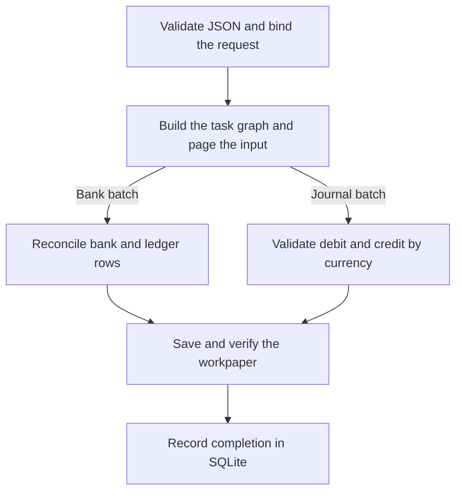

# LedgerSpec-LH

[](https://github.com/ReviveCoding/LedgerSpec-LH/actions/workflows/ci.yml)
[](https://github.com/ReviveCoding/LedgerSpec-LH/releases/latest)

LedgerSpec-LH is an offline accounting CLI for **bank reconciliation**, **double-entry journal validation**, and **auditable workpapers**. It proposes bank-to-ledger relationships, keeps ambiguous items available for review, and records each completed request in a local SQLite journal.

## Quick start

Requires Git and Python 3.11 or newer. The commands work in PowerShell and POSIX shells.

```sh
git clone https://github.com/ReviveCoding/LedgerSpec-LH.git
cd LedgerSpec-LH
python -m pip install .
python -c "from pathlib import Path; Path('runs').mkdir(exist_ok=True)"
ledgerspec reconcile examples/reconciliation.json --output runs/reconciliation --request-id example
ledgerspec journal examples/journal.json --output runs/journal --request-id journal
```

| Example | Expected result |
|---|---|
| [Bank reconciliation](examples/reconciliation.json) | L1 and B1 match. B2 remains for review with a 200-cent difference. |
| [Journal validation](examples/journal.json) | J1 is accepted with 10,000 cents on each side and a zero difference. |

Each command prints a JSON receipt with the workpaper and its SHA-256 digest. Repeating the exact request with the same output directory returns the saved receipt. See [usage](docs/usage.md) for input formats, output fields, and receipt handling.

## How it works



The reconciliation engine partitions transactions by account and currency, narrows candidates by date, and checks amount and reference evidence before proposing links. Ambiguous candidates remain in the workpaper. The journal validator uses integer cents and checks balance per currency.

## Evaluation

In prior offline R5 candidate tests, pair F1 on the **RecBench USD payout-to-bank subset** increased from **85.53% to 96.29%**. The median workflow time for a synthetic 1,000-row case decreased from **14.559 s to 1.029 s**. These are regression measurements on the evaluated inputs. GitHub CI exercises the portable CLI separately with synthetic fixtures. [Evaluation details and scope](docs/evaluation.md)

The CLI runs locally against supplied JSON and produces proposals for review. Financial posting and live bank connections are outside its scope.
